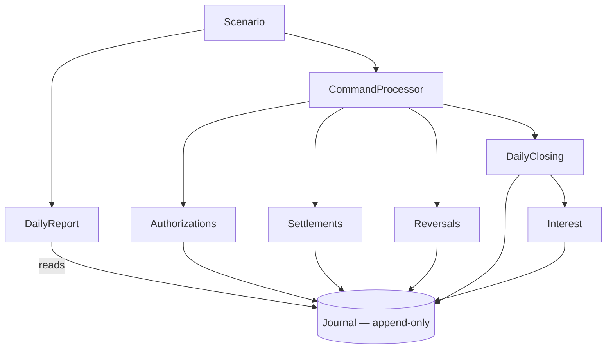
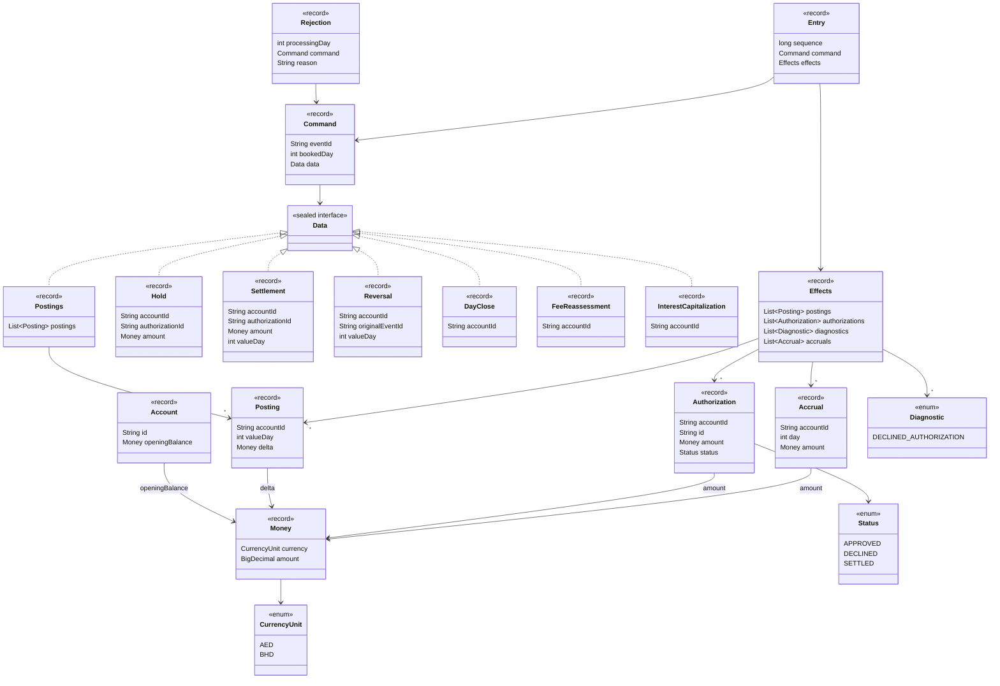

# Account Ledger


Account Ledger is an in-memory account ledger in **Java 21**, built around an append-only journal.
It processes six days of credits, debits, card authorizations, settlements and backdated corrections across AED and BHD accounts. 
Earlier views remain queryable after later events change the balances.

The application runs locally with no web layer, database, persistence or runtime libraries beyond the JDK. Each execution starts with fresh state.

## How to run the suite

Requires **JDK 21** and **Maven**; verified with Maven 3.6.3. From the repository root:

```sh
mvn test
./run.sh
```

The first command runs the suite and downloads build dependencies if needed.
`run.sh` compiles offline using that cache, then launches the scenario.

## Expected output

```text

Day 1 (sequence 4)
+---------+----------+---------+---------+-----------+-----------------+------------------+----------------+
| Account | Currency | Closing | On hold | Available | Revised closing | Fees (value day) | Authorizations |
+---------+----------+---------+---------+-----------+-----------------+------------------+----------------+
| ACC-001 | AED      |  250.00 |    0.00 |    250.00 |          250.00 | none             | none           |
| ACC-002 | BHD      |   0.000 |   0.000 |     0.000 |           0.000 | none             | none           |
+---------+----------+---------+---------+-----------+-----------------+------------------+----------------+
  Errors: none
  Diagnostics: none

Day 2 (sequence 7)
+---------+----------+---------+---------+-----------+-----------------+------------------+-----------------+
| Account | Currency | Closing | On hold | Available | Revised closing | Fees (value day) | Authorizations  |
+---------+----------+---------+---------+-----------+-----------------+------------------+-----------------+
| ACC-001 | AED      |  250.00 |  200.00 |     50.00 |          225.00 | none             | Auth-A=APPROVED |
| ACC-002 | BHD      |   0.000 |   0.000 |     0.000 |           0.000 | none             | none            |
+---------+----------+---------+---------+-----------+-----------------+------------------+-----------------+
  Errors: none
  Diagnostics: none

Day 3 (sequence 10)
+---------+----------+---------+---------+-----------+-----------------+------------------+-----------------+
| Account | Currency | Closing | On hold | Available | Revised closing | Fees (value day) | Authorizations  |
+---------+----------+---------+---------+-----------+-----------------+------------------+-----------------+
| ACC-001 | AED      |  650.00 |  200.00 |    450.00 |          625.00 | none             | Auth-A=APPROVED |
| ACC-002 | BHD      |   0.000 |   0.000 |     0.000 |           0.000 | none             | none            |
+---------+----------+---------+---------+-----------+-----------------+------------------+-----------------+
  Errors: none
  Diagnostics: none

Day 4 (sequence 13)
+---------+----------+---------+---------+-----------+-----------------+------------------+----------------+
| Account | Currency | Closing | On hold | Available | Revised closing | Fees (value day) | Authorizations |
+---------+----------+---------+---------+-----------+-----------------+------------------+----------------+
| ACC-001 | AED      |  465.00 |    0.00 |    465.00 |          415.00 | none             | Auth-A=SETTLED |
| ACC-002 | BHD      |   0.000 |   0.000 |     0.000 |           0.000 | none             | none           |
+---------+----------+---------+---------+-----------+-----------------+------------------+----------------+
  Errors: E6: Unknown authorization: Auth-Z
  Diagnostics: none

Day 5 (sequence 18)
+---------+----------+---------+---------+-----------+-----------------+---------------------------------------------+---------------------------------+
| Account | Currency | Closing | On hold | Available | Revised closing | Fees (value day)                            | Authorizations                  |
+---------+----------+---------+---------+-----------+-----------------+---------------------------------------------+---------------------------------+
| ACC-001 | AED      | -230.00 |    0.00 |   -230.00 |          390.00 | 25.00 (Day 2); 25.00 (Day 4); 25.00 (Day 5) | Auth-A=SETTLED; Auth-B=DECLINED |
| ACC-002 | BHD      |   0.000 |   0.000 |     0.000 |          10.000 | none                                        | none                            |
+---------+----------+---------+---------+-----------+-----------------+---------------------------------------------+---------------------------------+
  Errors: none
  Diagnostics: none

Day 6 (sequence 26)
+---------+----------+---------+---------+-----------+-----------------+------------------+---------------------------------+
| Account | Currency | Closing | On hold | Available | Revised closing | Fees (value day) | Authorizations                  |
+---------+----------+---------+---------+-----------+-----------------+------------------+---------------------------------+
| ACC-001 | AED      |  390.93 |    0.00 |    390.93 |          390.93 | none             | Auth-A=SETTLED; Auth-B=DECLINED |
| ACC-002 | BHD      |  10.008 |   0.000 |    10.008 |          10.008 | none             | none                            |
+---------+----------+---------+---------+-----------+-----------------+------------------+---------------------------------+
  Errors: none
  Diagnostics: none
```

### How to read the output & Notes

1. **Each day has one table with a row per account.** 
2. Balance columns align to the right, and column widths fit the full contents. 
3. Errors and diagnostics appear below the table.

| Field | Meaning |
| --- | --- |
| `Currency` | Currency of every amount in the row, including fees. AED keeps 2 decimal places; BHD keeps 3. |
| `Closing` | Ledger balance as known at that day's saved close, including fees. Day 6 also includes capitalized interest. |
| `On hold` | Total reserved by active authorizations at that same original close: `Closing − Available`. Settled and declined authorizations reserve nothing. |
| `Available` | Ledger minus active holds at that same original close. |
| `Revised closing` | Balance for the same value day using all knowledge at the final saved close. Later entries outside that saved window cannot change it. |
| `Fees (value day)` | New assessments recorded since the previous close. Charges are positive amounts; `(Day N)` states the value day when each debit affects the ledger. |
| `Authorizations` | Card authorization states as known at that day's saved close. An approved authorization reserves funds until it settles; recorded states are never re-evaluated against revised balances. |
| `Errors` / `Diagnostics` | Rejected attempts and accepted anomalies received that day, respectively. `none` is explicit; repeated failed attempts remain separate. |
| `sequence` | The saved journal prefix used for the historical view. The report also copies the rejection prefix because failures do not advance journal sequences. |

#### Notes

About the **retroactive** fees: 

* Day 2 originally closed at AED 250.00 with AED 50.00 available under Auth-A's hold. 
* Its revised closing balance is AED 225.00 after the backdated debit, reversal and retained Day 2 fee. 
* The fee appears in Day 5's report because that is when it was assessed. 
* E10 similarly revises BHD's Day 5 balance to 10.000 without changing its original zero close.

About **Card Authorizations & Settlements**: 

* Auth-A has settled and released its hold. 
* Auth-B was declined when it was requested. A decline is final, so a later capture against it would be recorded with a diagnostic but would move no money.
* E6 is rejected because Auth-Z has no preceding authorization.

About **Overdraft**: 

* All three overdraft fees fall on ACC-001 and total **AED 75.00**; ACC-002 never
goes negative, so it is charged none.

About **Capitalized interest**: 

* Capitalized interest is **AED 0.93** for ACC-001 and **BHD 0.008** for ACC-002. 

---

## The six-day scenario

Let's analize the **event stream**: first of all, both accounts open at zero: `ACC-001` in AED and `ACC-002` in BHD.
[Scenario.java](src/main/java/accountledger/scenario/Scenario.java) defines the stream used by both the executable and the complete-stream test.

| Processing day | Events, in arrival order |
| --- | --- |
| 1 | E1 credits AED 1,200.00; E2 debits AED 950.00. Both have value Day 1. |
| 2 | E3 commands Auth-A's AED 200.00 hold. |
| 3 | E4 credits AED 400.00, value Day 3. |
| 4 | E5 settles Auth-A for AED 185.00; E6 attempts to settle unknown Auth-Z for AED 180.00 and is rejected. Both commands specify value Day 4. |
| 5 | E7 debits AED 620.00, value Day 2; E8 commands Auth-B's AED 90.00 hold. |
| 6 | E9 reverses E7, value Day 2; E10 credits ACC-002 with BHD 10.000 in three installments, booked and valued on Day 5. |

Notes:

* E1–E9 belong to ACC-001. 
* **E10 arrives after E9**, even though its booked day is earlier. The driver preserves that order. 
Its installments are BHD 3.334, 3.333 and 3.333, which sum to exactly 10.000.
* Both accounts close after each row. Backdated changes trigger explicit
reassessments after E7, E9 and E10. Capitalization follows both Day 6 closes.

### The resulting journal

```text
seq  event             bkd  effect
  1  E1                  1  ACC-001 1200.00 @D1
  2  E2                  1  ACC-001 -950.00 @D1
  3  CLOSE-ACC-001-1     1  accruals 1d = 0.10
  4  CLOSE-ACC-002-1     1  accruals 1d = 0.000
  5  E3                  2  Auth-A=APPROVED
  6  CLOSE-ACC-001-2     2  accruals 2d = 0.20
  7  CLOSE-ACC-002-2     2  accruals 2d = 0.000
  8  E4                  3  ACC-001 400.00 @D3
  9  CLOSE-ACC-001-3     3  accruals 3d = 0.46
 10  CLOSE-ACC-002-3     3  accruals 3d = 0.000
 11  E5                  4  ACC-001 -185.00 @D4  Auth-A=SETTLED
 12  CLOSE-ACC-001-4     4  accruals 4d = 0.65
 13  CLOSE-ACC-002-4     4  accruals 4d = 0.000
 14  E7                  5  ACC-001 -620.00 @D2
 15  E7-FEES             5  ACC-001 -25.00 @D2  ACC-001 -25.00 @D4  accruals 4d = 0.10
 16  E8                  5  Auth-B=DECLINED
 17  CLOSE-ACC-001-5     5  ACC-001 -25.00 @D5  accruals 5d = 0.10
 18  CLOSE-ACC-002-5     5  accruals 5d = 0.000
 19  E9                  6  ACC-001 620.00 @D2
 20  E9-FEES             6  accruals 5d = 0.77
 21  E10                 5  ACC-002 3.334 @D5  ACC-002 3.333 @D5  ACC-002 3.333 @D5
 22  E10-FEES            6  accruals 5d = 0.004
 23  CLOSE-ACC-001-6     6  accruals 6d = 0.93
 24  CLOSE-ACC-002-6     6  accruals 6d = 0.008
 25  INTEREST-ACC-001    6  ACC-001 0.93 @D6
 26  INTEREST-ACC-002    6  ACC-002 0.008 @D6
```

### How the final amounts are obtained

The resulting balances and revised daily accruals are:

| Day | AED ledger before capitalization | AED interest | BHD ledger before capitalization | BHD interest |
| --- | ---: | ---: | ---: | ---: |
| 1 | 250.00 | 0.10 | 0.000 | 0.000 |
| 2 | 225.00 | 0.09 | 0.000 | 0.000 |
| 3 | 625.00 | 0.25 | 0.000 | 0.000 |
| 4 | 415.00 | 0.17 | 0.000 | 0.000 |
| 5 | 390.00 | 0.16 | 10.000 | 0.004 |
| 6 | 390.00 | 0.16 | 10.000 | 0.004 |
| **Interest total** | | **0.93** | | **0.008** |


---

## Rules and policy choices

| Area | Behavior |
| --- | --- |
| Money | `BigDecimal` amounts use AED's 2 decimals or BHD's 3. Inputs requiring rounding are rejected; calculations round explicitly. No currency conversion. |
| Journal | Each accepted command and its immutable effects share one sequence. Validation finishes before anything is appended. Existing records are never changed or deleted. |
| Authorizations | Available balance is ledger balance minus active holds. Approve only when applying the new hold leaves availability at or above zero. Holds do not change the ledger balance. |
| Settlements | A settlement requires an approved authorization. A reference absent from that account's history is rejected without a debit; a recorded but declined reference is written to the journal with a diagnostic and moves no money. Only an approved reference is captured, once, releasing the entire hold. |
| Reversals | Append the opposite of every posting in the referenced event. Preserve authorization decisions and separately assessed fees. Explicit fee refunds require their own compensation. |
| Overdraft fees | Charge AED 25.00 at most once per account and value day when the closing ledger balance is negative. Reassess closed days chronologically, including the effect of earlier fees. |
| Interest | Accrue 0.04% daily on positive ledger balances after fees, using `HALF_EVEN` at the account's precision. Accruals stay unspendable until capitalization. |
| Capitalization | Credit the exact sum of the six rounded daily accruals once, at the end of Day 6. Day 6 earns interest before that credit; no remainder is discarded. |

---

## Code map

All application code is under [`src/main/java/accountledger`](src/main/java/accountledger).

| Package | Responsibility |
| --- | --- |
| [`accountledger.domain`](src/main/java/accountledger/domain) | `Money` and `CurrencyUnit`, and the immutable records that carry commands and their effects: `Account`, `Command`, `Posting`, `Authorization`, `Accrual`, `Diagnostic`, `Rejection`, `CommandRejectedException`. |
| [`accountledger.core`](src/main/java/accountledger/core) | The journal and the accounting operations that read and write it: command processing, authorizations, settlements, reversals, daily closing and interest. |
| [`accountledger.scenario`](src/main/java/accountledger/scenario) | The executable six-day scenario and its daily report. |

`domain` is independent, `core` uses `domain`, and `scenario` uses both.



| Component | Responsibility |
| --- | --- |
| [Scenario](src/main/java/accountledger/scenario/Scenario.java) | Executable stream, daily boundaries and final capitalization. |
| [DailyReport](src/main/java/accountledger/scenario/DailyReport.java) | Saved closes, original and revised balances, daily fees, states and errors. |
| [CommandProcessor](src/main/java/accountledger/core/CommandProcessor.java) | Dispatch commands and record expected rejections. |
| [Journal](src/main/java/accountledger/core/Journal.java) | Atomic append, shared retry detection and historical queries. |
| [Money](src/main/java/accountledger/domain/Money.java) | Currency precision, exact arithmetic, rounding and installment splitting. |
| [Authorizations](src/main/java/accountledger/core/Authorizations.java) | Availability, approval decisions and active hold state. |
| [Settlements](src/main/java/accountledger/core/Settlements.java) | Final debits, hold release and settlement diagnostics. |
| [Reversals](src/main/java/accountledger/core/Reversals.java) | Reference validation and compensating postings. |
| [DailyClosing](src/main/java/accountledger/core/DailyClosing.java) | Daily close markers, fee assessment and updated accruals. |
| [Interest](src/main/java/accountledger/core/Interest.java) | Rounded daily accruals and final capitalization. |

The operations above read and write these records. Only postings move money.



| Record | Role |
| --- | --- |
| [Command](src/main/java/accountledger/domain/Command.java) · `Command.Data` | The input: an event ID, a booked day and one of seven typed payloads — `Postings`, `Hold`, `Settlement`, `Reversal`, `DayClose`, `FeeReassessment`, `InterestCapitalization`. Record equality decides whether a submission is a retry. |
| [Account](src/main/java/accountledger/domain/Account.java) | An ID and an opening balance. The balance carries the currency, so the account does not repeat it. |
| [Journal.Entry](src/main/java/accountledger/core/Journal.java) · `Effects` | One accepted command and everything it produced, visible together under one sequence. E10 is one entry with three postings. |
| [Posting](src/main/java/accountledger/domain/Posting.java) | One account, one signed amount, one value day. A line, not a transaction: one command may produce several. |
| [Authorization](src/main/java/accountledger/domain/Authorization.java) | A hold decision — `APPROVED`, `DECLINED` or `SETTLED` — with the original hold amount. Only the latest approved state reserves funds. |
| [Accrual](src/main/java/accountledger/domain/Accrual.java) | Rounded interest for one value day. A fact, not money, until capitalization posts the total. |
| [Diagnostic](src/main/java/accountledger/domain/enums/Diagnostic.java) | An anomaly on an accepted entry; the account and reference are in that entry's command. |
| [Rejection](src/main/java/accountledger/domain/Rejection.java) | One failed attempt with its processing day and reason. Kept by `CommandProcessor`, outside the journal. |
| [CommandRejectedException](src/main/java/accountledger/domain/CommandRejectedException.java) | The expected domain failure `CommandProcessor` catches and records; anything else propagates. |
| [Money](src/main/java/accountledger/domain/Money.java) · [CurrencyUnit](src/main/java/accountledger/domain/enums/CurrencyUnit.java) | An exact decimal at its currency's scale — AED 2 places, BHD 3 — with explicit rounding and installment splitting. |

---

## Tests and the deliberate counterexample

The ordinary suite covers decimal precision, atomic writes, retries, historical views, holds, settlements, reversals, fees, interest and rejected attempts.
* [DailyClosingTest](src/test/java/accountledger/core/DailyClosingTest.java) checks close and fee assessment rules;
* [ScenarioTest](src/test/java/accountledger/scenario/ScenarioTest.java) checks the complete scenario's financial results, arrival order and closing boundaries.
* [DailyReportTest](src/test/java/accountledger/scenario/DailyReportTest.java) checks all six daily outputs, historical availability, late BHD credit, capitalization, fee dates, errors and immutable report boundaries. 

**One test is designed to fail.** The brief requires it, and it exists to show
what the fee-retention policy costs rather than to hide it.

[FeeTimingCounterexample](src/test/java/accountledger/core/FeeTimingCounterexample.java)
runs the same three steps in two orders (a debit of AED 10.00, its reversal, and the Day 1 close) and asserts that the order makes no difference to the final balance:

| Order | Balance at the close | Final balance |
| --- | --- | ---: |
| debit → **reverse** → close | 0.00, so no fee | **0.00** |
| debit → close → **reverse** | -10.00, so the AED 25.00 overdraft fee is assessed | **-25.00** |

The principal cancels in both. The overdraft fee does not: a reversal appends
only the opposite of the original postings, so a fee already assessed at a
close stays. The reversal itself charges nothing; keeping the fee is a policy
choice, argued under criterion 6 in [REJECTED.md](REJECTED.md). The assertion
therefore fails, and that failure is the documented behaviour.

Run it on its own:

```sh
mvn -o -Dtest=FeeTimingCounterexample test
```

> [!IMPORTANT]
> **Expected: one assertion failure, zero errors, nonzero exit.** A passing run
> would mean the fee-retention policy had changed.

---

## Scope and documentation

The core is designed for a single-threaded replay of one six-day window.
Holds have no automatic expiry, settlements are final, and reversals are full.

| Document | Contents | 
| --- | --- |
| [AMBIGUITIES.md](AMBIGUITIES.md) | Unspecified behavior and the decisions applied. |
| [NUMBERS.md](NUMBERS.md) | The constants in the production code and why each has its value. |
| [REJECTED.md](REJECTED.md) | Refused criteria, policy alternatives and approaches replaced during development. |
| [WORKLOG.md](WORKLOG.md) | Timestamped implementation and verification history. |
