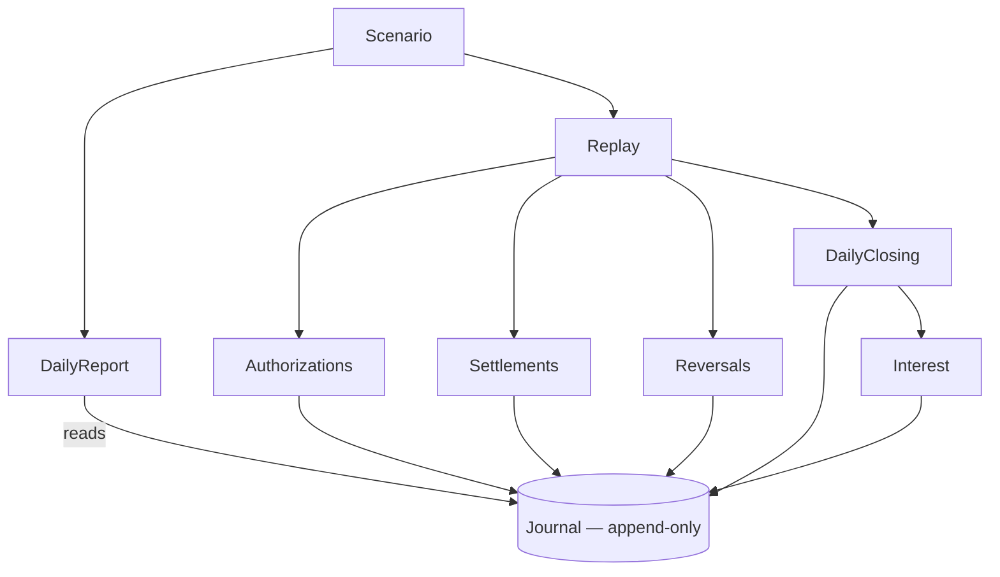

# Memory Account Ledger


MAL is an in-Memory Account Ledger in **Java 21**, built around an append-only journal.
It replays six days of credits, debits, card authorizations, settlements and
backdated corrections across AED and BHD accounts. Earlier views remain
queryable after later events change the balances.

The application runs locally with no web layer, database, persistence or runtime
libraries beyond the JDK. Each execution starts with fresh state.

> [!NOTE]
> **Current status:** the ledger core, test suite and executable replay are
> implemented. The command prints all six daily closes, including historical
> states, fee assessments, errors and balances revised at the end of Day 6.

**Acceptance audit:** criterion 4 is now implemented: an unknown authorization's
settlement is rejected without a debit. For criterion 6, E9 compensates E7 only;
the separately assessed fees remain. Automatic fee restoration is refused under
that documented interpretation. See [REJECTED.md](REJECTED.md) for the reasoning.

## Quick start

Requires **JDK 21** and **Maven**; verified with Maven 3.6.3. From the repository root:

```sh
mvn test
./run.sh
```

The first command runs the suite and downloads build dependencies if needed.
`run.sh` compiles offline using that cache, then launches the scenario. On
subsequent runs, the suite can also run offline with `mvn -o test`.

## Expected output

```text
Closing and available use each day's saved close.
Revised closing uses the final saved close: Day 6 (sequence 26).

Day 1 (sequence 4)
  ACC-001 | closing AED 250.00 | available AED 250.00 | revised closing AED 250.00
    Fees assessed today: none
    Authorizations: none
  ACC-002 | closing BHD 0.000 | available BHD 0.000 | revised closing BHD 0.000
    Fees assessed today: none
    Authorizations: none
  Errors: none
  Diagnostics: none

Day 2 (sequence 7)
  ACC-001 | closing AED 250.00 | available AED 50.00 | revised closing AED 225.00
    Fees assessed today: none
    Authorizations: Auth-A=APPROVED
  ACC-002 | closing BHD 0.000 | available BHD 0.000 | revised closing BHD 0.000
    Fees assessed today: none
    Authorizations: none
  Errors: none
  Diagnostics: none

Day 3 (sequence 10)
  ACC-001 | closing AED 650.00 | available AED 450.00 | revised closing AED 625.00
    Fees assessed today: none
    Authorizations: Auth-A=APPROVED
  ACC-002 | closing BHD 0.000 | available BHD 0.000 | revised closing BHD 0.000
    Fees assessed today: none
    Authorizations: none
  Errors: none
  Diagnostics: none

Day 4 (sequence 13)
  ACC-001 | closing AED 465.00 | available AED 465.00 | revised closing AED 415.00
    Fees assessed today: none
    Authorizations: Auth-A=SETTLED
  ACC-002 | closing BHD 0.000 | available BHD 0.000 | revised closing BHD 0.000
    Fees assessed today: none
    Authorizations: none
  Errors: E6: Unknown authorization: Auth-Z
  Diagnostics: none

Day 5 (sequence 18)
  ACC-001 | closing AED -230.00 | available AED -230.00 | revised closing AED 390.00
    Fees assessed today: AED 25.00 (value Day 2); AED 25.00 (value Day 4); AED 25.00 (value Day 5)
    Authorizations: Auth-A=SETTLED; Auth-B=DECLINED
  ACC-002 | closing BHD 0.000 | available BHD 0.000 | revised closing BHD 10.000
    Fees assessed today: none
    Authorizations: none
  Errors: none
  Diagnostics: none

Day 6 (sequence 26)
  ACC-001 | closing AED 390.93 | available AED 390.93 | revised closing AED 390.93
    Fees assessed today: none
    Authorizations: Auth-A=SETTLED; Auth-B=DECLINED
  ACC-002 | closing BHD 10.008 | available BHD 10.008 | revised closing BHD 10.008
    Fees assessed today: none
    Authorizations: none
  Errors: none
  Diagnostics: none
```

### How to read the report

| Field | Meaning |
| --- | --- |
| `closing` | Ledger balance as known at that day's saved close, including fees. Day 6 also includes capitalized interest. |
| `available` | Ledger minus active holds at that same original close. |
| `revised closing` | Balance for the same value day using all knowledge at the final saved close. Later entries outside that saved window cannot change it. |
| `Fees assessed today` | New assessments recorded since the previous close. Charges are positive amounts; `value Day` states when each debit affects the ledger. |
| `Authorizations` | States known at the original close. They are never reevaluated using revised balances. |
| `Errors` / `Diagnostics` | Rejected attempts and accepted anomalies received that day, respectively. `none` is explicit; repeated failed attempts remain separate. |
| `sequence` | The saved journal prefix used for the historical view. The report also copies the rejection prefix because failures do not advance journal sequences. |

Day 2 originally closed at AED 250.00 with AED 50.00 available under Auth-A's
hold. Its revised closing balance is AED 225.00 after the backdated debit,
reversal and retained Day 2 fee. The fee appears in Day 5's report because
that is when it was assessed. E10 similarly revises BHD's Day 5 balance to
10.000 without changing its original zero close.

Auth-A has settled and released its hold. Auth-B was declined when it was
requested; E9 does not change that decision. E6 is rejected because Auth-Z has
no preceding authorization. Its AED 180.00 never leaves the account.

The three overdraft fees total **AED 75.00**. Capitalized interest is
**AED 0.93** and **BHD 0.008**. These values are calculated by the core and
verified by the tests.

---

## The six-day scenario

Both accounts open at zero: `ACC-001` in AED and `ACC-002` in BHD.
[Scenario.java](src/main/java/accountledger/Scenario.java) defines the stream
used by both the executable and the complete-stream test.

| Processing day | Events, in arrival order |
| --- | --- |
| 1 | E1 credits AED 1,200.00; E2 debits AED 950.00. Both have value Day 1. |
| 2 | E3 requests Auth-A's AED 200.00 hold. |
| 3 | E4 credits AED 400.00, value Day 3. |
| 4 | E5 settles Auth-A for AED 185.00; E6 attempts to settle unknown Auth-Z for AED 180.00 and is rejected. Both requests specify value Day 4. |
| 5 | E7 debits AED 620.00, value Day 2; E8 requests Auth-B's AED 90.00 hold. |
| 6 | E9 reverses E7, value Day 2; E10 credits ACC-002 with BHD 10.000 in three installments, booked and valued on Day 5. |

E1–E9 belong to ACC-001. **E10 arrives after E9**, even though its booked day
is earlier. The driver preserves that order. Its installments are BHD 3.334,
3.333 and 3.333, which sum to exactly 10.000.

Both accounts close after each row. Backdated changes trigger explicit
reassessments after E7, E9 and E10. Capitalization follows both Day 6 closes.

### How the final amounts are obtained

E7 makes Day 2's balance **AED -370.00 before fees**. Reassessment charges
Day 2 and Day 4; the Day 5 close adds the third fee. After the Day 2 fee,
Day 3 is still positive at AED 5.00, so it incurs no fee.

E9 reverses the debit and retains the separately assessed fees. The resulting
balances and revised daily accruals are:

| Day | AED ledger before capitalization | AED interest | BHD ledger before capitalization | BHD interest |
| --- | ---: | ---: | ---: | ---: |
| 1 | 250.00 | 0.10 | 0.000 | 0.000 |
| 2 | 225.00 | 0.09 | 0.000 | 0.000 |
| 3 | 625.00 | 0.25 | 0.000 | 0.000 |
| 4 | 415.00 | 0.17 | 0.000 | 0.000 |
| 5 | 390.00 | 0.16 | 10.000 | 0.004 |
| 6 | 390.00 | 0.16 | 10.000 | 0.004 |
| **Interest total** | | **0.93** | | **0.008** |

This table uses the accepted effects of the ten input attempts and the fee
assessments, before the final interest credits. It is a revised view:
the original Day 2 AED close was 250.00,
and the original Day 5 BHD close was 0.000. Both remain queryable using their
saved journal sequences.

---

## Rules and policy choices

| Area | Behavior |
| --- | --- |
| Money | `BigDecimal` amounts use AED's 2 decimals or BHD's 3. Inputs requiring rounding are rejected; calculations round explicitly. No currency conversion. |
| Journal | Each accepted request and its immutable effects share one sequence. Validation finishes before anything is appended. Existing records are never changed or deleted. |
| Authorizations | Available balance is ledger balance minus active holds. Approve only when applying the new hold leaves availability at or above zero. Holds do not change the ledger balance. |
| Settlements | Reject a reference absent from that account's authorization history without a debit. Otherwise allow one final capture and release the entire approved hold. A declined but recorded reference produces a debit and a diagnostic. |
| Reversals | Append the opposite of every posting in the referenced event. Preserve authorization decisions and separately assessed fees. Explicit fee refunds require their own compensation. |
| Overdraft fees | Charge AED 25.00 at most once per account and value day when the closing ledger balance is negative. Reassess closed days chronologically, including the effect of earlier fees. |
| Interest | Accrue 0.04% daily on positive ledger balances after fees, using `HALF_EVEN` at the account's precision. Accruals stay unspendable until capitalization. |
| Capitalization | Credit the exact sum of the six rounded daily accruals once, at the end of Day 6. Day 6 earns interest before that credit; no remainder is discarded. |

E9 reverses E7's AED 620.00 principal only; it does not automatically refund
AED 75.00 assessed in separate entries. Explicit refunds would be compatible
with append-only, but are not implied by the adopted reversal scope.
[REJECTED.md](REJECTED.md) explains the refusal of automatic restoration in
criterion 6. [AMBIGUITIES.md](AMBIGUITIES.md) records the decisions applied.

---

## Dates, history and retries

The ledger keeps these concepts separate:

| Term | Meaning |
| --- | --- |
| Processing day | When the driver handles a request; stored with rejected attempts. |
| Booked day | The day declared by the request. It can move backwards as events arrive. |
| Value day | When a posting affects the ledger balance. |
| Sequence | The accepted entry's position in the journal, always increasing. |

`balance(accountId, valueDay, knownThroughSequence)` includes postings up to
both bounds, inclusively. `available` requires the same two bounds; holds apply
according to the decisions known at that sequence. Save the closing sequence
to reproduce an original close.

This independent Java example records E1, E2 and a later correction, without
running daily closes or assessing fees. The statements can be entered in
`jshell --class-path target/classes` after compilation:

```java
import accountledger.*;
import java.util.List;
import static accountledger.CurrencyUnit.AED;

var journal = new Journal(new Account("ACC-001", Money.of(AED, "0.00")));
journal.append("E1", 1, List.of(new Posting("ACC-001", 1, Money.of(AED, "1200.00"))));
journal.append("E2", 1, List.of(new Posting("ACC-001", 1, Money.of(AED, "-950.00"))));
long original = journal.lastSequence();

var late = journal.append("E7", 5,
        List.of(new Posting("ACC-001", 2, Money.of(AED, "-620.00"))));
journal.balance("ACC-001", 2, original);        // AED 250.00
journal.balance("ACC-001", 2, late.sequence()); // AED -370.00
```

`Journal` owns retry detection. An identical request returns its original
outcome without recalculation; reusing its ID with different input is rejected.
Earlier approvals, declines and historical snapshots survive later corrections.

`Replay.process(processingDay, request)` returns `false` after recording an
expected rejection, leaving balances and holds unchanged. Each failed attempt
remains in an append-only log and does not reserve its event ID. It may succeed
later if corrected or if a missing prerequisite arrives. Declines and accepted
diagnostics return `true`.

`DailyReport.capture` saves a copy of `replay.rejections()` alongside the
journal cutoff after each day. Both prefixes remain fixed when later events
arrive; rejected attempts do not advance journal sequences.

---

## Code map

All application code is under [`src/main/java/accountledger`](src/main/java/accountledger).



| Component | Responsibility |
| --- | --- |
| [Scenario](src/main/java/accountledger/Scenario.java) | Executable stream, daily boundaries and final capitalization. |
| [DailyReport](src/main/java/accountledger/DailyReport.java) | Saved closes, original and revised balances, daily fees, states and errors. |
| [Replay](src/main/java/accountledger/Replay.java) | Dispatch requests and record expected rejections. |
| [Journal](src/main/java/accountledger/Journal.java) | Atomic append, shared retry detection and historical queries. |
| [Money](src/main/java/accountledger/Money.java) | Currency precision, exact arithmetic, rounding and installment splitting. |
| [Authorizations](src/main/java/accountledger/Authorizations.java) | Availability, approval decisions and active hold state. |
| [Settlements](src/main/java/accountledger/Settlements.java) | Final debits, hold release and settlement diagnostics. |
| [Reversals](src/main/java/accountledger/Reversals.java) | Reference validation and compensating postings. |
| [DailyClosing](src/main/java/accountledger/DailyClosing.java) | Daily close markers, fee assessment and updated accruals. |
| [Interest](src/main/java/accountledger/Interest.java) | Rounded daily accruals and final capitalization. |

A `Request` is the original input. A `Posting` is a signed monetary movement.
A `Journal.Entry` groups the request with its effects: postings, authorization
states, diagnostics and accruals. One entry can contain several postings, as E10 does.

---

## Tests and the deliberate counterexample

The ordinary suite covers decimal precision, atomic writes, retries, historical
views, holds, settlements, reversals, fees, interest and rejected attempts.
[DailyClosingTest](src/test/java/accountledger/DailyClosingTest.java) checks the
complete scenario's financial results;
[ScenarioTest](src/test/java/accountledger/ScenarioTest.java) checks arrival order
and closing boundaries. [DailyReportTest](src/test/java/accountledger/DailyReportTest.java)
checks all six daily outputs, historical availability, late BHD credit,
capitalization, fee dates, errors and immutable report boundaries. The ordinary
suite contains **187 tests**. Maven stores reports in `target/surefire-reports/`.

One required test deliberately challenges the chosen fee-retention policy.
Run it separately:

```sh
mvn -o -Dtest=FeeTimingCounterexample test
```

> [!IMPORTANT]
> **Expected result: one assertion failure and a nonzero exit.** Reversing before
> close leaves AED 0.00; reversing after close leaves AED -25.00 because the
> assessed fee is retained. This exposes the policy's dependence on timing.
[FeeTimingCounterexample.java](src/test/java/accountledger/FeeTimingCounterexample.java)
explains it inline. Its class name excludes it from the default test selection;
it is not disabled.

---

## Scope and documentation

The core is designed for a single-threaded replay of one six-day window.
Holds have no automatic expiry, settlements are final, and reversals are full.
A negative BHD close is rejected because no BHD overdraft fee was specified.
Capitalization freezes accruals; reopening finalized interest requires a future
explicit policy.

Replay accepts already constructed, typed requests. Construction failures happen
before this API receives the input. It catches `RequestRejectedException` only;
other exceptions propagate.

| Document | Contents |
| --- | --- |
| [AMBIGUITIES.md](AMBIGUITIES.md) | Unspecified behavior and the decisions applied. |
| [NUMBERS.md](NUMBERS.md) | Constants, fixture values and their rationale. |
| [REJECTED.md](REJECTED.md) | Refused criteria, policy alternatives and approaches replaced during development. |
| [WORKLOG.md](WORKLOG.md) | Timestamped implementation and verification history. |
